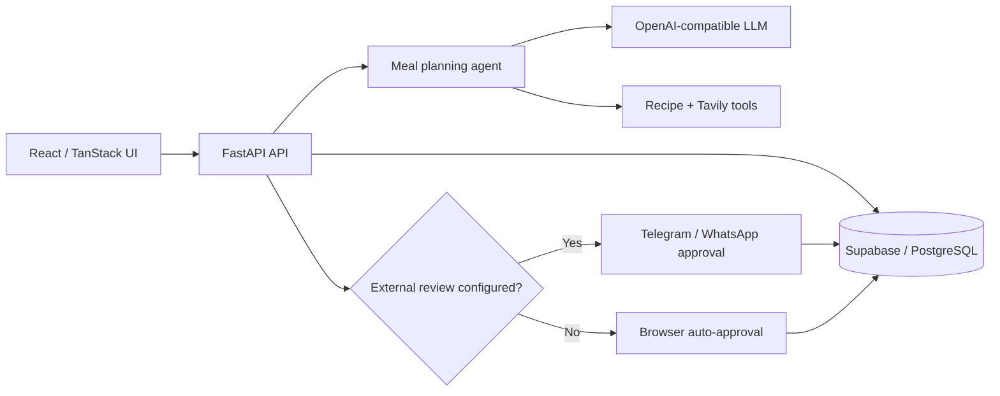

# Mansi Gangwar — AI Engineering Portfolio

**Senior Software Engineer | AI Engineering | Generative AI | Agentic Systems | Distributed Systems**

I am a senior software engineer at SAP Labs working on SAP SuccessFactors, with more than eight years of experience in enterprise SaaS, Java backend engineering, distributed systems, and cloud applications. I am building toward AI engineering roles by combining that foundation with practical work in Python, FastAPI, LLM integration, agent orchestration, tool calling, and retrieval-augmented generation.

[Live portfolio website](https://mansi1892.github.io/ai-engineering-portfolio/) · [Download resume](./portfolio-website/assets/Mansi_Gangwar_Resume.pdf) · [LinkedIn](https://www.linkedin.com/in/mansi-gangwar-588551136) · [Email](mailto:mansigangwar18@gmail.com)

[Website source](./portfolio-website/) · [Smart Meal AI live application](https://smart-meal-ai-one.vercel.app) · [GitHub profile](https://github.com/Mansi1892)

> This repository is source-first: project claims are tied to included implementations. Smart Meal AI is my original project. Other projects are included with permission and explicitly labeled as contributed/adapted work. See [ATTRIBUTION.md](./ATTRIBUTION.md).

## Featured project — Smart Meal AI

Smart Meal AI is a full-stack meal-planning system for Indian households. It combines a FastAPI API, React/TanStack frontend, Supabase persistence, structured LLM generation, recipe retrieval, and optional Telegram or WhatsApp review flows.



Key capabilities verified in the source:

- Seven-day structured plan generation with dietary, allergy, budget, calorie, and protein checks
- Per-person family targets and plan views with a shared grocery list
- Weekly history, version grouping, planning streaks, and repeat-meal avoidance
- Supabase-backed users, family members, plans, groceries, feedback, credits, and support tickets
- Password login/reset flow plus admin credit and support management
- Telegram and WhatsApp plan delivery, approval, rejection, and targeted regeneration paths
- Combined React + FastAPI deployment configuration for Vercel

[Read the complete project guide](./projects/smart-meal-ai/README.md) · [Inspect the source](./projects/smart-meal-ai/)

## Project portfolio

### Original work

| Project | What is implemented | Stack | Status |
|---|---|---|---|
| [Smart Meal AI](./projects/smart-meal-ai/) | Full-stack household meal planner, LLM workflow, persistence, admin, support, and messaging approvals | Python, FastAPI, React 19, TanStack, Supabase, OpenAI-compatible APIs, Tavily | Source included; frontend build and Python tests validated |

### Contributed and adapted projects

| Area | Project | Included implementation |
|---|---|---|
| RAG & agents | [ConsultFlow AI](./projects/rag-agentic/consultflow-ai/) | Six n8n workflows for ingestion, discovery, research, storyline, QA, and Slides delivery; screenshots and system documentation |
| Agentic automation | [Knoxx Outbound Intelligence](./projects/ai-automation/knoxx-outbound-intelligence-n8n/) | React frontends, Supabase schema/functions, five n8n workflows, evaluation datasets, contract tests, and architecture docs |
| Agentic automation | [AI Customer Support Chatbot](./projects/ai-automation/ai-customer-support-chatbot-n8n/) | Importable n8n workflow and operating guide |
| Agentic automation | [Webhook Chatbot](./projects/ai-automation/webhook-chatbot-n8n/) | Importable n8n LangChain agent skeleton |
| AI automation | [Job Application Bot](./projects/ai-automation/job-application-bot-n8n/) | Importable n8n workflow and configuration guide |
| AI automation | [Lead Scoring](./projects/ai-automation/lead-scoring-n8n/) | Three workflow revisions, Python reference pipeline, schemas, React/HTML operator UIs, fixtures, and sample output |
| AI automation | [Stock Analyser Agent](./projects/ai-automation/stock-analyser-agent-n8n/) | Importable scheduled analysis workflow |
| AI automation | [SupplierSnap](./projects/ai-automation/suppliersnap-n8n/) | Importable supplier-risk workflow |
| Application | [Advance Learner Hub](./projects/ai-applications/advance-learner-hub/) | React 19/TanStack directory application with CSV-backed data |
| Application | [Ask Kyo Insight](./projects/ai-applications/ask-kyo-insight/) | React CX intelligence and call-evaluation prototype with Supabase integration |
| Application | [Call Insight Craft](./projects/ai-applications/call-insight-craft/) | React call-evaluation dashboard prototype |
| Application | [Frame Guide](./projects/ai-applications/lenskart-frame-guide/) | React guided recommendation and chatbot prototype |
| Application | [Marzi Companion](./projects/ai-applications/marzi-gentle-companion/) | React wellness personalization prototype |
| Application | [Resume AI Builder Pro](./projects/ai-applications/resume-aibuilder-pro/) | React/Zustand multi-step resume tailoring prototype with Vitest setup |
| Application | [RiseUp](./projects/ai-applications/riseup-app/) | Create React App morning assistant prototype |
| Application | [SentiSum Diagnostic](./projects/ai-applications/sentisum-diagnostic/) | Vanilla frontend and Vercel serverless report-generation endpoint |

Detailed classification, dependencies, environment requirements, and run commands are in the [complete project inventory](./docs/project-overview/PROJECT_INVENTORY.md).

## Technical profile

| Domain | Technologies and practices |
|---|---|
| Backend engineering | Java, Spring Boot, Spring MVC, REST APIs, microservices, multitenant applications |
| AI engineering | Python, FastAPI, LLM integrations, LangChain-style orchestration, AI agents, tool calling, RAG concepts |
| Distributed systems | Kafka, event-driven architecture, Redis caching, reliability and performance optimization |
| Data | SQL, PostgreSQL, Supabase, data modeling, persistence workflows |
| Frontend represented here | React, TypeScript, TanStack Router/Query, Vite, Tailwind CSS |
| Automation represented here | n8n, webhooks, scheduled workflows, structured LLM output, human approval gates |
| Cloud and delivery | Cloud applications, Vercel, Cloudflare Workers configurations, GitHub Actions |

Technologies under “AI engineering” describe learning and practical application represented in this portfolio; they do not imply professional production experience unless explicitly stated.

## Professional experience

### SAP Labs — Senior Software Developer

**December 2019 – Present · Bangalore, India**

- Reduced backend latency from approximately 1 second to under 200 milliseconds using caching and reliability patterns; also reduced deployment time by 30%.
- Designed Kafka-based event-driven microservices handling millions of events per day across multi-tenant background workflows.
- Built distributed backend services for complex organizational reorganization workflows and hierarchical transformations.
- Led a team of 4 engineers, mentored 10+ engineers, and reviewed 500+ pull requests to strengthen architecture and API quality.

### Huawei — Associate Developer

**October 2017 – November 2019 · Bangalore, India**

- Built Spring Boot REST and full-stack features supporting two agile releases per month.
- Migrated legacy applications to Spring Boot and led backend refactoring to reduce coupling and improve API performance.
- Defined service boundaries and reusable data flows while maintaining MySQL and Oracle data access layers.

## Education and certification

- **M.Tech (Hons.) in Information Security**, Birla Institute of Technology, Ranchi — 2015–2017
- **B.Tech (Hons.) in Computer Science**, SRMS, Bareilly — 2010–2014
- **Microsoft Certified: Azure AI Fundamentals (AI-900)** — September 2023

## Repository structure

```text
AI-Portfolio/
├── portfolio-website/              # Recruiter-facing static portfolio
├── projects/
│   ├── smart-meal-ai/              # Original full-stack AI application
│   ├── rag-agentic/                # RAG / multi-stage agent workflows
│   ├── ai-automation/              # n8n systems and operator interfaces
│   └── ai-applications/             # Source-complete frontend prototypes
├── prompt-engineering/prompts/     # Ten documented prompt patterns
├── productivity-tools/             # Curated reference document
├── docs/
│   ├── architecture/               # Cross-project architecture notes
│   ├── project-overview/           # Audited source inventory
│   ├── setup-guides/               # Local development instructions
│   └── source-material/             # Retained project notes
├── ATTRIBUTION.md
└── README.md
```

## Run locally

### Portfolio website

Public URL: [mansi1892.github.io/ai-engineering-portfolio](https://mansi1892.github.io/ai-engineering-portfolio/)

```bash
cd portfolio-website
python3 -m http.server 4173
```

Open <http://localhost:4173>.

### Smart Meal AI

```bash
cd projects/smart-meal-ai
python3 -m venv .venv
source .venv/bin/activate
pip install -r requirements.txt
cp .env.example .env
uvicorn api:app --host 127.0.0.1 --port 8000
```

In a second terminal:

```bash
cd projects/smart-meal-ai/frontend
npm ci
npm run dev -- --host 0.0.0.0 --port 8080
```

Real Supabase and model credentials are required for data-backed and generation flows. Never commit the resulting `.env` files.

See the [local development guide](./docs/setup-guides/LOCAL_DEVELOPMENT.md) for every project family.

## Architecture documentation

- [Portfolio architecture patterns](./docs/architecture/PORTFOLIO_ARCHITECTURE.md)
- [Complete source inventory](./docs/project-overview/PROJECT_INVENTORY.md)
- [Security review](./docs/SECURITY_REVIEW.md)
- [Smart Meal AI project guide](./projects/smart-meal-ai/README.md)
- [Knoxx architecture and workflow guide](./projects/ai-automation/knoxx-outbound-intelligence-n8n/README.md)
- [ConsultFlow RAG and agent pipeline](./projects/rag-agentic/consultflow-ai/README.md)

## Provenance and security

- This repository has a new, independent Git history and is not a fork.
- Nested `.git` directories and the original repositories' histories were not copied.
- The source repositories remain unchanged.
- Real credential-like values discovered during import were removed and replaced with placeholders.
- `.env.example` files document required configuration; `.env` files are ignored.
- One source submodule, `repo-showcase-quest`, was inaccessible at its configured URL and is not represented as copied source.

Review [ATTRIBUTION.md](./ATTRIBUTION.md) and [docs/SECURITY_REVIEW.md](./docs/SECURITY_REVIEW.md) before publication.

## Contact

- Email: [mansigangwar18@gmail.com](mailto:mansigangwar18@gmail.com)
- LinkedIn: [linkedin.com/in/mansi-gangwar-588551136](https://www.linkedin.com/in/mansi-gangwar-588551136)
- Resume: [Mansi Gangwar — Resume](./portfolio-website/assets/Mansi_Gangwar_Resume.pdf)
- GitHub: [github.com/Mansi1892](https://github.com/Mansi1892)
