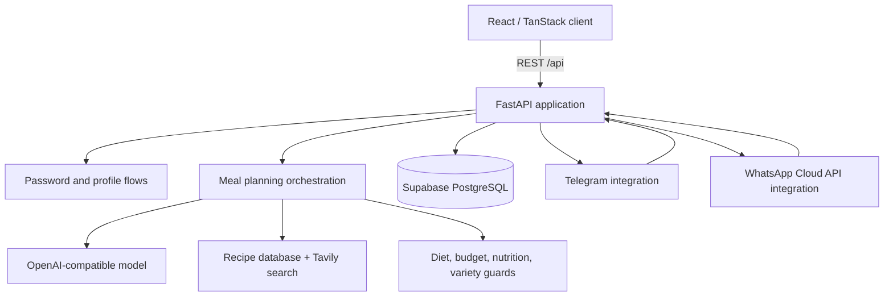
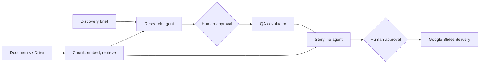
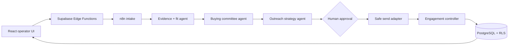
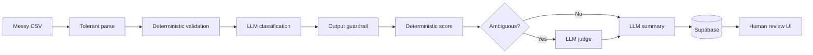

# Architecture patterns across the portfolio

The projects in this repository are independent applications and workflows rather than one deployable monolith. This document highlights the repeated engineering patterns they demonstrate.

## 1. Full-stack AI application

Smart Meal AI is the most complete application architecture in the repository.

Important decisions visible in the source:

- Model output is normalized into a structured weekly plan before persistence.
- Deterministic dietary checks and replacements surround probabilistic generation.
- The application stores plan versions and recent meals, allowing regeneration without losing history and reducing repetition.
- External approval is optional. Users without a configured messaging channel follow a browser-only auto-approval path.
- Credits, support tickets, password reset state, and administrator operations are stored as application data rather than browser-only mock state.

## 2. Gate-based agent pipeline

ConsultFlow AI separates an open-ended deliverable into approved stages.

The workflow JSON is the executable artifact. The included screenshots document a frontend, but the source repository did not contain that frontend implementation in this project directory; this repository does not claim otherwise.

## 3. Evidence-backed outbound orchestration

Knoxx Outbound Intelligence combines deterministic data contracts, agent stages, external providers, and explicit safety controls.

This project contains the strongest examples of idempotency, safe test delivery, organization-level stop rules, golden evaluation datasets, and contract tests.

## 4. Resilient batch automation

The lead-scoring project treats malformed input and model failure as expected workflow states.

## Cross-cutting principles

1. **Use models for judgment, not basic computation.** Email parsing, score calculation, permissions, and data validation should remain deterministic.
2. **Persist state between stages.** Long-running or externally reviewed workflows need durable IDs, versions, and resumable status.
3. **Make human approval a first-class transition.** Approval should be modeled in the state machine, not handled as an informal side channel.
4. **Design for partial failure.** A provider error should produce a visible, recoverable state instead of silently dropping work or terminating a batch.
5. **Separate browser-safe configuration from server secrets.** Publishable client keys still belong in environment configuration; service-role and model credentials never belong in frontend code.

